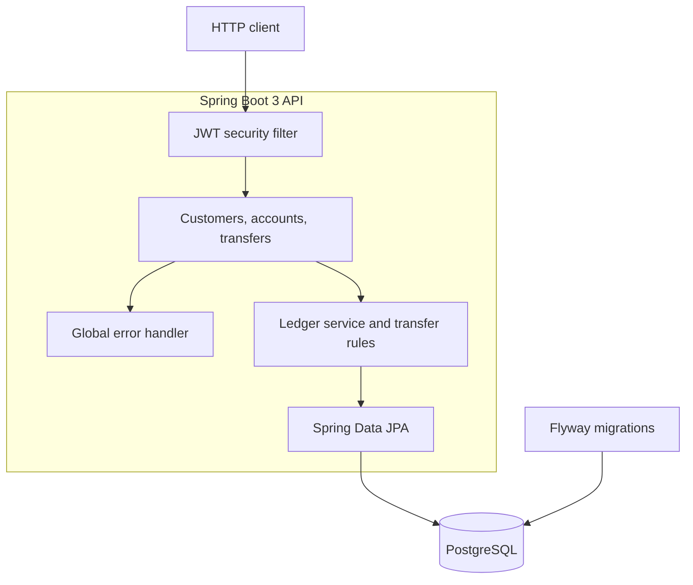

# Banking Ledger API

A small double-entry banking ledger. It records customers, deposit accounts, and money movement as balanced journal entries. Amounts are `BigDecimal`. Account updates use optimistic locking (`@Version`) so concurrent transfers cannot silently overwrite a balance.

This is a portfolio demo by Arpan Bom. It is not a bank, it does not move real money, and it is not production-hardened.

## Architecture



A transfer writes two lines that must balance: a debit on the sending customer account and a credit on the receiving one. A deposit debits the internal USD cash account and credits the customer account. Customer balances are liabilities, so a credit increases them. The API stores the idempotency key on the journal. Replaying the same key and body returns the original journal and does not post again.

## Run

Java 21 and Maven 3.9+ (or the included wrapper). Postgres is the primary database.

```bash
docker compose up -d
./mvnw spring-boot:run
```

The API listens on port 8094. Interactive docs: [http://localhost:8094/swagger-ui.html](http://localhost:8094/swagger-ui.html).

To boot without Docker, use the in-memory H2 profile. That profile is only a local stand-in:

```bash
./mvnw spring-boot:run -Dspring-boot.run.profiles=h2
```

Demo operator login, seeded on startup:

- username: `demo`
- password: `demo-password`

Override the JWT HMAC secret with `LEDGER_JWT_SECRET` (base64, at least 32 bytes). The value in `application.yml` is for local development.

Example:

```bash
TOKEN=$(curl -s -X POST http://localhost:8094/api/v1/auth/token \
  -H 'Content-Type: application/json' \
  -d '{"username":"demo","password":"demo-password"}' | jq -r .accessToken)

curl -s -X POST http://localhost:8094/api/v1/customers \
  -H "Authorization: Bearer $TOKEN" \
  -H 'Content-Type: application/json' \
  -d '{"name":"Ada Lovelace","email":"ada@example.com"}'
```

Deposits and transfers require an `Idempotency-Key` header (8 to 128 characters: letters, digits, `.`, `_`, `:`, `-`). Only USD accounts are supported. There is no foreign exchange.

| Method | Path | Purpose |
| --- | --- | --- |
| POST | `/api/v1/auth/token` | Issue a JWT |
| POST | `/api/v1/customers` | Create a customer |
| GET | `/api/v1/customers/{id}` | Fetch a customer |
| POST | `/api/v1/accounts` | Open a USD liability account |
| GET | `/api/v1/accounts/{id}` | Balance, status, and version |
| POST | `/api/v1/accounts/{id}/deposits` | Fund an account |
| POST | `/api/v1/transfers` | Move money between customer accounts |
| GET | `/api/v1/accounts/{id}/entries` | Journal lines for an account |

Failed business rules return `application/problem+json`.

## Test

Local tests are JUnit 5. Transfer rules run as plain unit tests. Service tests, including the concurrent-transfer cases, run on H2 through Spring Boot. Testcontainers is on the classpath but excluded unless you opt in.

```bash
./mvnw test
```

The GitHub Actions workflow runs the same Maven build on JDK 21 and includes the Postgres Testcontainers test:

```bash
./mvnw -Pci test
```

That profile needs Docker. Do not treat it as a benchmark; it only checks that a deposit and a transfer commit on Postgres.

## Limits

- One shared operator login. Customers do not authenticate.
- No holds, overdraft product, interest, statements, or payment-network messages.
- Optimistic locking retries a few times, then returns HTTP 409.
- The H2 profile does not replace Postgres for a real deployment.

## License

MIT. Copyright 2026 Arpan Bom.
